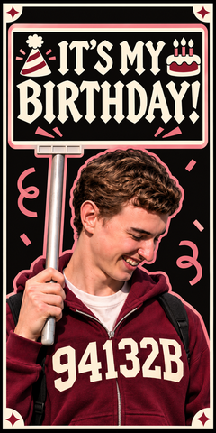

# Birthday screen (V5 power button at the top)

This adds the approved birthday artwork as a static SD-card screen. The image is decoded once and kept in memory; display redraws do not reload the SD file. No additional display task, touch actions, or fallback dashboard are added.

## SD card

1. Extract `assets/birthday-SD-CARD.zip` onto the root of a FAT32 microSD card supported by the Brain.
2. Check that the card contains `birthday/top_cw.png`, with no extra outer folder.
3. Insert the card before starting the program.

The same file is available directly at `assets/sdcard/birthday/top_cw.png`. It is a single 480x240 RGB24 PNG, not the old Python dashboard's BMP tiles. Its LVGL path is `S:birthday/top_cw.png`, corresponding to `/usd/birthday/top_cw.png` in PROS.

The picture is already rotated clockwise for the Brain mounted vertically with its power button at the TOP. Display it at native size without further rotation. In normal landscape orientation, the power button is on the right when viewed from the front; physically rotating the Brain counterclockwise moves that button to the top. The clockwise asset compensates. See the [official VEX layout photo](https://kb.vex.com/hc/en-us/articles/17783141418516-Connecting-with-App-based-VEXcode-V5-Windows).

Upright native-resolution preview:



The supplied artwork was resized proportionally and rotated. Its face, sign, hat, cake, and chest lettering were preserved without regeneration or added decorations. Original supplied artwork; artist/photographer attribution was not supplied. This integration does not assert ownership or add an artwork license.

## Program

Build and download the existing C++ project using PROS as usual. The project already includes PROS 4.2.2, LemLib 0.5.6 and liblvgl 9.2.0 with PNG/SD support. No new dependency or Makefile change is needed.

`initialize()` calls `birthday_ui::show_on_boot()` first. The previous LLEMU diagnostics view and its repeating task are removed so they cannot overwrite the artwork. The autonomous angle diagnostic goes to the PROS terminal instead. Motor mappings, controller behavior, mechanism settings, calibration, camera setup and autonomous actions are preserved.

The helper queues one callback on the existing LVGL display task, retaining its decoded pixel buffer for the program's lifetime (about 450 KiB plus decoder overhead). Missing/invalid images or allocation failures produce a terminal diagnostic and leave the default empty display; initialization continues. There is no retry loop, SD prompt, or backup UI.

Call the helper only once, first in `initialize()`. This bundled library's `lv_lock()` is a no-op. Its boot scheduling checks the LVGL 9.2.0 timer state and relies on initialize's priority being above PROS's display task priority. All image/widget work then runs inside the LVGL callback. Do not add concurrent LVGL/LLEMU writers or move the helper into a control loop. Review this integration when changing LVGL version, OS configuration, heap configuration, or display task priorities.

## Validation and remaining hardware work

The helper passed a strict host C++23 compilation against these repository headers and nine host scenarios: one-time success, missing image, wrong image size, decode failure, unexpected rotation, callback queue failure, busy handler timeout, incorrect caller priority, and widget allocation failure. Asset dimensions, PNG encoding, ZIP paths and pixel/source preservation were checked locally.

To reproduce the display simulations on a Mac with Xcode Command Line Tools, from the project root:

```sh
clang++ -std=c++23 -Wall -Wextra -Werror -Iinclude src/ui/birthday_ui.cpp tests/birthday_ui_host.cpp -o /tmp/94132b-birthday-ui-host
for scenario in happy missing size decode rotation queue busy priority allocation; do
  /tmp/94132b-birthday-ui-host "$scenario" || exit 1
done
```

Both the unmodified base program and this program produce the same eight host Clang narrowing diagnostics in the AprilTag `double corners` initializer. Both pass the host syntax check with only that existing diagnostic suppressed. The camera/autonomous code was left unchanged apart from its LCD log destination. A full ARM/PROS build also passed using `make -j4` with Arm GNU Toolchain 15.2.Rel1 (GCC 15.2.1), against upstream `e44ccddce449a388fcb9fd63f5c19256915c8590`. The real ARM compiler reported those same eight existing narrowing warnings but no errors; the birthday helper compiled without warnings. Both cold and hot program packages linked successfully. The project Makefile and compiler flags were unchanged.

**Actual Brain/SD-card testing has not been performed.** Verify the orientation, decoding, available memory, image visibility, and normal mechanism/competition operation on hardware before deployment. Compilation and host simulations do not establish physical behavior. No UI debug labels or telemetry overlays are drawn.
